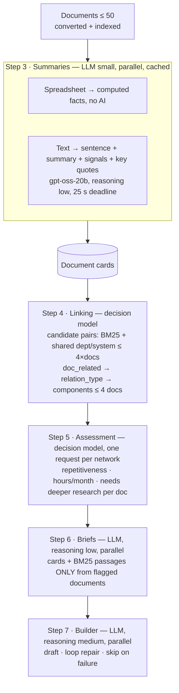

# Explorer agent — architecture

Oct 4, 2026 · @Marco

The Explorer finds repetitive, automatable work in a company's documents. It runs discovery steps 3–5 under Husk Op (`app/core/agents/orchestrator.py`). The Planner (step 6) writes a brief per workflow, and the Builder (step 7) drafts the automations.

**Who does what:**
- **an LLM writes text**: card summaries (small model), briefs, drafts;
- **a decision model decides**: links, relation types, repetitiveness, hours, depth. It is Venice Jev today and Husk AI's Serenity later; see [DECISION_MODEL.md](DECISION_MODEL.md).

## Workflow

## Step 3 — document cards

Code: `explorer/summarizer.py`, `knowledge/tabular/facts.py`; table `document_cards`.

- **Card fields:**
  - `title`, `sentence` (one), `summary` (≤ 600 characters);
  - `signals`: `rep`, `manual`, `freq`, `dept`, `vol`, `sys` (spreadsheets: rows, cadence, rows per day, empty cells, duplicates);
  - `quotes`: ≤ 3 key quotes with passage ids, validated in code (spreadsheets: computed facts `S1…`).
- **Spreadsheets:** computed locally, **no model call**.
- **Text:** one structured call on the summary model (json-schema mode). `sentence` and `summary` are written in the **document's language** (detected at ingest, English when unsure; spreadsheet labels follow it too); the company facts and the `freq`/`dept`/`sys` tags stay in the **user's** language, quotes stay verbatim. `CARD_VERSION` 3. Per document: summary model → main model → a basic card within **25 s**. Late documents get **20 s more**, then their full card is rebuilt in the background.
- **Cache:** per `sha256` + `CARD_VERSION`. Concurrency 8.

## Step 4 — linking (decision model)

Code: `ExplorerAgent.link_documents`.

1. **Candidate pairs, in code:** BM25 neighbours (top 4 per card) plus pairs sharing a department or system, capped at **4 × documents**. Never n².
2. **`doc_related`** for every pair, in a few batched requests, with the state = all cards. Kept if **p ≥ 0.75**; uncertain counts as no.
3. **`relation_type`** for every kept edge.
4. **Networks:** connected components, split above **4 documents** at their weakest edges. A lone document with a card signal ≥ 0.6 becomes its own network.
5. **Notes:** each card becomes a validated note (no LLM), linked along the edges.

## Step 5 — assessment (decision model)

Code: `ExplorerAgent.assess`.

- One request per network, all in parallel. State = the network's cards + links.
- **Questions:** `repetitive` (score 0–1), `hours` (8 buckets per month) and `deeper_<doc>` (noul per document).
- **Code:**
  - keeps networks with repetitiveness ≥ 0.5;
  - ranks them by hours and keeps the top 8;
  - hours/week = the expected bucket midpoint ÷ 4.33 (the spread is kept);
  - documents with deeper ≥ 0.6 go to the Planner.

## Step 6–7

- **Briefs** (`planner/agent.py`): the network's card summaries plus 4 BM25 passages from each **flagged** document only. The LLM returns the Builder prompt and complete notes (evidence = passage + quote). Hours come from the decision model.
- **Builder:** all drafts in parallel at reasoning medium. Loops are repaired in code before re-asking the model. A failed draft is skipped and the run continues.

## Time and cost controls

- **Reasoning effort:** low across discovery, medium for the Builder, never high (`HUSK_REASONING_<ROLE>`).
- **Output caps per role.** The Builder is capped at 4,000 output tokens (a runaway guard).
- **json-schema mode** only for the small schemas; function calling for drafts (strict JSON on the large draft schema ran away to 117k tokens).
- **Benchmarks only:** OpenRouter throughput routing.
- **Metering:** per step and per model, LLM and decision model alike (`app/core/metering.py`). It appears on the report and in the benchmark.

## Measured (Valsorda, 30 documents)

| Design | Time | Calls | Cost | Planted tasks |
|---|---|---|---|---|
| Agent loop (removed) | 30 min | 100 | $0.033 | 7/9 |
| One-shot LLM (removed) | 9 min | 47 | $0.012 | 8/9 |
| **Decision model (current)** | **29 s** | 75 (17 decision requests) | $0.014 | 6/9 |

Full report: [benchmarks/results/DISCOVERY_BENCHMARK.md](../../benchmarks/results/DISCOVERY_BENCHMARK.md).

**Known gaps:**
- One noise opportunity: a lone document that passed the signal rule.
- Hours are overestimated: 60.8 h/week against 25.7 planted.
- Recall 6/9.

These are tuning targets for the gates and for Serenity's calibration.

## Suggestions reuse the same pieces

When documents are added after a discovery (`core/suggestions/engine.py`):
- the new document gets its card (cached);
- `suggest_changes` reads the card plus its quotes;
- new drafts go through a Planner brief, then the Builder;
- `refresh_network` writes card notes, with no extra AI call.
